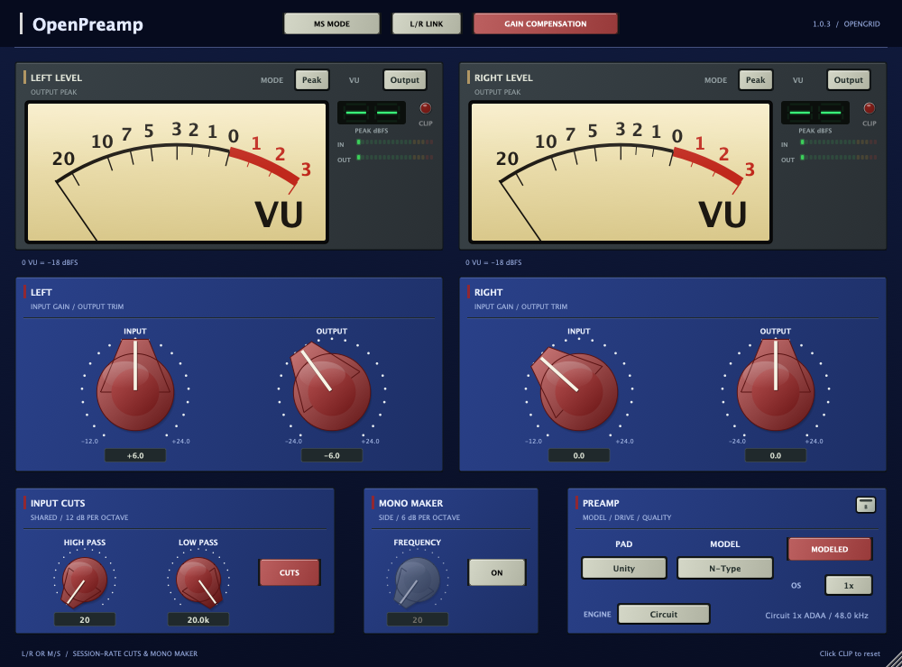

# OpenPreamp 1.0.3 control updates

These changes are included in the 1.0.3 source and Mac release package.

- **MODEL:** Off, Brit, N-Type, FSF, A-Type. N-Type remains selected for new
  instances. Only the menu order changes; saved model indices retain their meaning.
- **ENGINE:** Circuit and HQ. Circuit is the existing reduced engine; its fidelity
  limitations remain documented in the engineering reports. HQ stays the factory
  engine. The interface no longer calls Circuit “Preview.”
- **OS:** only 1x, 2x and 4x appear in the menu. Initial rates are 1x for Standard
  and Circuit, 2x for HQ. Mode changes use these initial rates until the user makes
  a rate choice; after that, mode changes preserve the selected rate. That choice
  is saved. Retired legacy values remain readable for old sessions/automation,
  but cannot be selected from the plugin menu.
- **Header:** MS MODE, L/R LINK and GAIN COMPENSATION form one horizontally centered group with equal gaps.
- **GAIN COMPENSATION:** off initially. Turning either INPUT or OUTPUT moves the
  paired control inversely in dB, maintaining their sum. Enabling the mode does
  not change current gains. Both controls stop when either reaches its limit.
  This operates independently for Left/Right or Mid/Side. Existing **L/R LINK**
  still shares the left input/output values between stereo channels.
- The mouse wheel raises/lowers gain or frequency while hovering over any of the
  seven knobs. Clicking a knob selects it for wheel editing; wheel events over the
  surrounding plugin area then adjust that selected knob. Hovering another knob
  takes precedence. Disabled right-channel controls remain disabled under L/R Link.

Gain compensation is a control link, not measured automatic loudness matching.
It pairs mouse drag, wheel, keyboard and double-click edits. Both gain parameters
are written through the host, saved and can be recorded as automation. Host-driven
changes or restored parameter values do not recursively generate new edits;
automating only one gain parameter directly still changes only that parameter.
PAD and the nonlinear preamp response remain independent.

The added compensation parameter is appended after existing parameters. Model,
engine and oversampling indices are retained for compatibility. Existing states
without the compensation parameter restore it off.

Validation uses `OpenPreampSmoke --controls`, the full processor/UI smoke suite
and the real-time callback allocation test. The focused suite checks menu order,
initial/manual rate selection, state restore, inverse gain edits, limits, filter
wheel response and editor containment at default/minimum sizes.

## Verified on Apple Silicon and Intel

32 focused control checks and 555 processor/UI smoke checks passed on each architecture.
The realtime allocation results and source hashes are recorded in
[controls-validation.json](controls-validation.json). The
rendered centered header was inspected; containment passed at default and minimum
editor sizes. Installed development comparison plugins were not replaced during validation.
Release build, architecture and notarization evidence is included with the 1.0.3 release.
