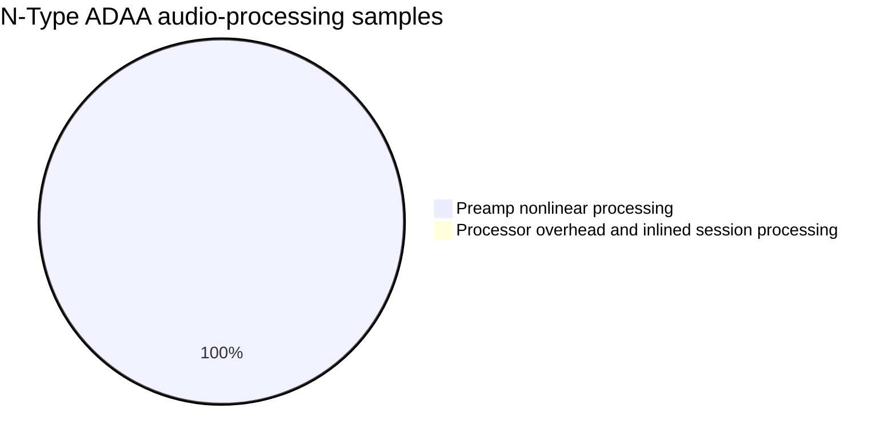

# OpenPreamp 1.0.1 CPU reduction — development

**Superseded development status, 2026-10-15:** VERSION is now 1.0.2. This report
records the initial 1.0.1 light-table checkpoint. Reduced previews were subsequently
implemented for all four circuits, but none passed every declared fidelity gate.
Full remains the default. See [the measured-engine plan](REDUCED_ENGINE_PLAN.md)
and `Performance-1.0.2` for the new stage-identification pipeline and current work.

Measured on 2026-10-09 using an Apple M1 Max, macOS 15.7.5,
arm64 Release builds with developer UI disabled. Reference DSP is 2c870de
(the post-1.0.0 Linux dependency fix), with the improved benchmark harness.
This is a development checkpoint, not a signed/notarized release.

## Measurement contract

`OpenPreampCPU` reports single-thread elapsed processing time divided by the
exact audio duration, expressed as a percentage. It excludes input construction,
input copying, plug-in preparation, table construction and editor rendering.
It includes parameter reads, audio metering, default cuts, trims and latency
padding. There is no GUI open in the benchmark. System scheduling is not pinned;
these numbers are local measurements, not universal performance-core guarantees.

Each repetition has 50 ms of untimed warm-up, then feeds the same precomputed
input; histories continue between repetitions. Model/rate configuration occurs
outside timing. Silence after another workload can include decaying filter state.
The full matrix covers stereo, 48/96 kHz, buffers 32/64/256, all four colored
models plus Off, and silence, 997 Hz tone, near-full-scale tone, 60 Hz + 7 kHz
two-tone, and seeded noise. `--input-wav` adds real material (linearly resampled
outside timing when its rate differs). Synthetic fixtures are not listening tests.

CPU is summarized with median/min/max across repetitions. Worst block time and
buffer-deadline overruns are also recorded; OS scheduling can create outliers.
Only the processing call is timed, using a clock pair per block.

## Baseline and profile

The 48 kHz / 64-sample quick baseline uses 0.5 seconds of measured audio per
repetition and three repetitions. All Circuit/HQ paths still run the released
network equations. See [baseline CSV](Performance-1.0.1/circuit-baseline.csv).

A separate Instruments Time Profiler recording selected N-Type ADAA, silence
and near-full-scale tone. Audio-processing stacks were isolated from preparation,
fixture generation and framework startup. The recording included warm-up.



Leaf sample attribution: exp 53.93%, solveLeg 20.94%, solveLoop 10.01%,
log1p 6.47%, pow 4.08%. Categories reflect symbols available in the optimized
binary: small session operations may be inlined into processor overhead.
Almost all sampled processing ran on performance cores, but scheduling was
not constrained. See [profile summary](Performance-1.0.1/n-type-profile.txt).
Detailed Instruments data stays in the ignored local build directory.

## First implementation

Only the lighter Brit and N-Type curves are accelerated. Circuit/HQ, resampling,
filters, external input drive, host latency and parameter IDs remain unchanged.
Shared HybridEQ defaults to the reference implementation; OpenPreamp opts in.

Fixed-unity curves are built during preparation and shared between instances.
Brit uses 8193 input samples and 4097 output samples; N-Type uses two 4097-point
curves. They occupy approximately 160 KiB combined, with each model's working
set smaller. Linear interpolation substitutes for repeated nested calculations.
Out-of-domain inputs use the original curve instead of clamping.

The existing eight-point numerical ADAA integration is retained for this first
step; switching to an integrated lookup-table primitive is separate future work.
N-Type retains its original outer solves and warm-start/DC histories. Quadrature
points more than 0.25 from the warm value use the original calculation, preserving
finite-iteration behavior on abrupt jumps. Non-unity internal gain also retains
the reference path. Input/PAD drive remains external, as in 1.0.0.

An initial attempt to remove N-Type's outer solves failed the waveform error
gate. The final conservative path passed all 144 comparisons across 44.1/48/96
kHz, two models, six amplitudes (0.001 through 50), and tone, two-tone, noise,
impulse/step/decaying-burst fixtures using irregular blocks. Worst peak sample
error was 0.0000191033; worst RMS residual was -97.29 dB relative to the reference.
Variable internal gain retained bit-identical reference output in both tests.
The gate is peak error < 0.00002 and residual < -85 dB, with finite output.

Focused high-frequency alias checks use actual external +12 dB drive, matching
the OpenPreamp routing, and allow at most 0.2 dB alias-ratio increase versus the
reference. These checks do not establish listening equivalence to the full circuit.

## Measured result and validation

The complete reference and candidate light-path matrices each contain 150 configurations,
with three repetitions and 0.5 seconds of measured audio per repetition.
Candidate measurements were repeated after all builds and tests had finished.

At 48 kHz / 64 samples, near-full-scale 997 Hz tone, stereo:

| Model | Reference CPU | Candidate CPU | Speedup |
|---|---:|---:|---:|
| Brit | 16.93% | 0.91% | 18.69x |
| N-Type | 147.54% | 18.05% | 8.17x |
| FSF | 1.29% | 1.30% | 0.99x |
| Off | 0.24% | 0.26% | 0.91x |
| A-Type | 0.59% | 0.61% | 0.97x |

Speedup varies with input, rate and buffer size; overload fallback work remains.
Across the non-silent synthetic workloads in the full matrix:

- Brit: 17.12–19.96x, median 18.47x.
- N-Type: 5.59–8.22x, median 7.96x.

FSF, Off and A-Type processing is unchanged; small timing differences reflect run variability.
CPU percentages measure single-thread wall time, not total machine CPU.

- 144 waveform comparisons, two exercised-path gates and two variable-gain equality checks: passed.
- Analytic/numerical ADAA, stability and eight model/rate alias comparisons: passed, zero failures.
- Processor routing, state, automation, latency, stereo tools and UI: 226 checks passed, zero failures.
- Native arm64 VST3: version 1.0.1, developer mode OFF, strict ad-hoc signature verification passed.

The VST3 is a local development artifact, not universal or Apple-notarized. No plug-in was
installed, no release was published and no temporary comparison plug-in was removed.
Listening approval on real material and Intel/universal validation are still pending.

Raw results: [reference](Performance-1.0.1/reference-light.csv),
[candidate](Performance-1.0.1/candidate-light.csv),
[waveform comparison](Performance-1.0.1/light-table-comparison.txt),
[alias checks](Performance-1.0.1/adaa.txt),
[processor/UI checks](Performance-1.0.1/smoke.txt).

## Reproduce

```sh
cmake -S . -B build -DCMAKE_BUILD_TYPE=Release -DOPENPREAMP_DEVELOPER_MODE=OFF
cmake --build build --config Release --target OpenPreampCPU OpenPreampLightTables OpenPreampADAA OpenPreampSmoke -j 8
./build/OpenPreampCPU_artefacts/Release/OpenPreampCPU --mode 0 --seconds 0.5 --repeats 3 --reference-light > reference-light.csv
./build/OpenPreampCPU_artefacts/Release/OpenPreampCPU --mode 0 --seconds 0.5 --repeats 3 > candidate-light.csv
./build/OpenPreampLightTables_artefacts/Release/OpenPreampLightTables
./build/OpenPreampADAA_artefacts/Release/OpenPreampADAA
./build/OpenPreampSmoke_artefacts/Release/OpenPreampSmoke
```

`--quick` limits the matrix to 48 kHz / 64 samples and silence/driven tone;
`--model` and `--mode` isolate configurations. Run performance measurements
serially, without builds or other benchmarks running. Instruments adds overhead,
so its profiled CPU measurements are excluded from the comparison table.

## Remaining stages

1. Listen to level-matched reference/candidate exports on real program material.
2. Profile the remaining N-Type outer solves and overload fallbacks before changing them.
3. Evaluate integrated curve tables and verify their alias/response changes.
4. Fit a separate reduced dynamic model to the full circuit's frequency response,
   harmonics, IMD and recovery; do not assume the current light model is equivalent.
5. Revisit coefficient caching and SIMD where measurements justify the work.

The 1–1.5% budget and a 5x full-circuit speedup are not established by this work.
The released Circuit/HQ model and installed comparison plug-ins are preserved.
