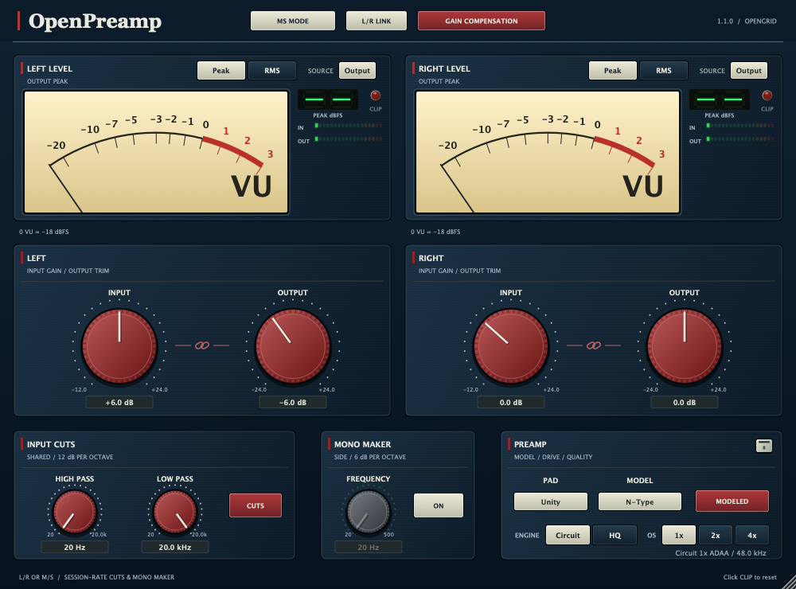

# OpenPreamp 1.1.0 GUI update

The approved visual concept is implemented as vector drawing, not a raster image
covering controls. The shared navy chassis uses quiet panel texture, cream meters,
tactile coloured knobs, explicit units and centered header controls. Model-specific
knob/accent colours remain. Signed VU scale labels clarify levels below reference;
VU calibration/ballistics and peak/RMS calculations are unchanged.

Peak and RMS are both visible. Circuit/HQ and 1x/2x/4x also have direct keys;
selection uses the original host parameters and gestures. The SOURCE key still
toggles Input/Output. The retired rate is not offered. New instances retain N-Type,
HQ/2x and compensation off; choosing a rate preserves it across engine changes.

Gain compensation shows a link between each available input/output pair. It still
couples user edits inversely, independently of L/R LINK. In linked stereo only the
left pair is interactive; in M/S each pair remains independent. No new audio
parameters or DSP changes are part of this GUI update. All four existing preamps
remain; the tube model is deferred in TUBE_PREAMP_ENGINEERING_PLAN.md.

The style is opt-in on components, with no global Theme mutation or changes to
shared HybridEQ presentation. Proportional resizing remains 400 x 296 to 1500 x
1110. Knob gestures, wheel editing and saved parameter identities are retained.

The 1.0.3 measurement report stays versioned as captured. It is not relabeled as
new 1.1.0 audio data. GUI verification uses control/processor tests and snapshots
of the actual editor, including all models, M/S, linked, RMS and minimum size.

## Validation

37 control checks pass on each architecture, 555 processor/UI checks pass on
Apple Silicon, and 960 realtime callbacks per architecture have no C++ heap
allocations or frees. Universal VST3, AU, CLAP and LV2 builds and format checks
pass. See [validation evidence](Validation-1.1.0/gui-validation.json) and logs.
All 15 manual pages and editor snapshots were visually reviewed. No new live
DAW listening sign-off is claimed. The latest packaged release remains 1.0.3.
