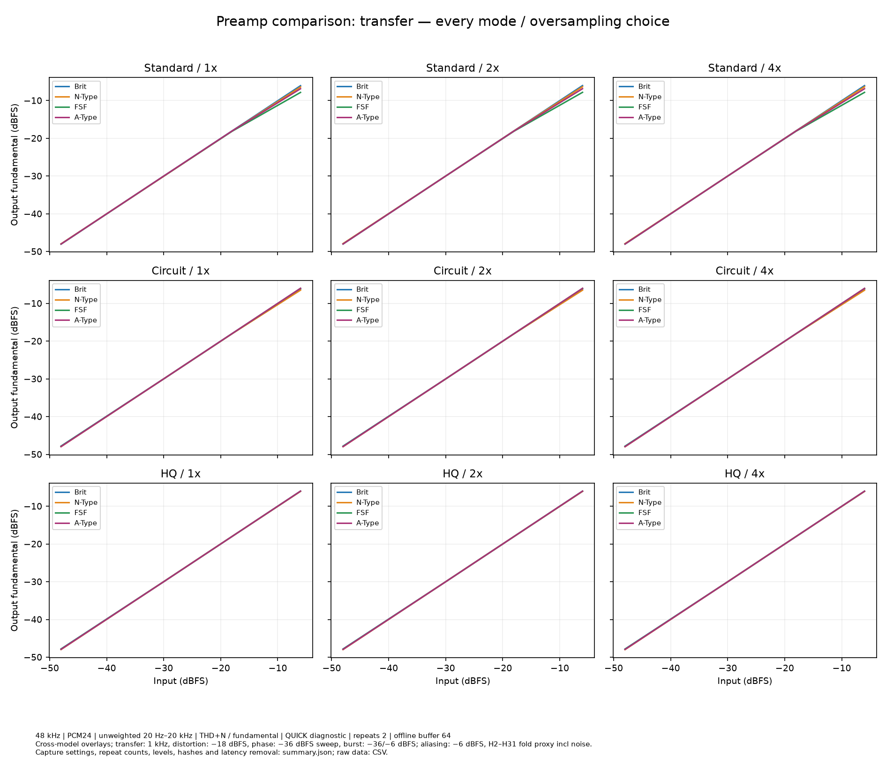
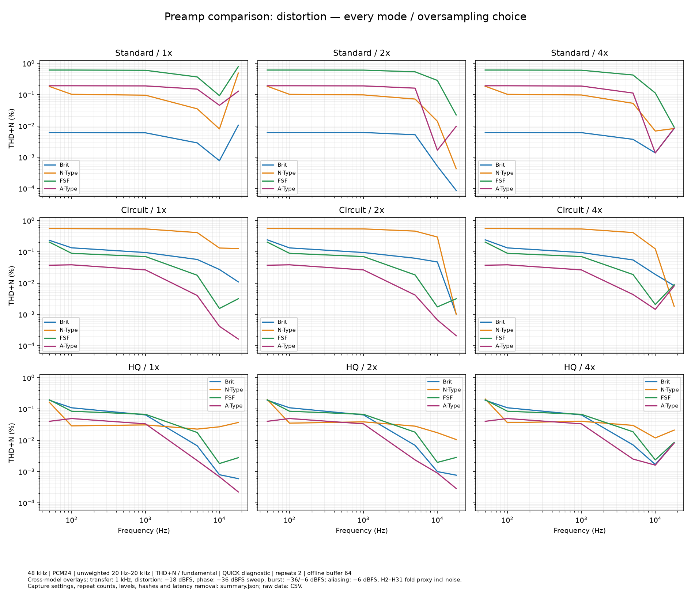
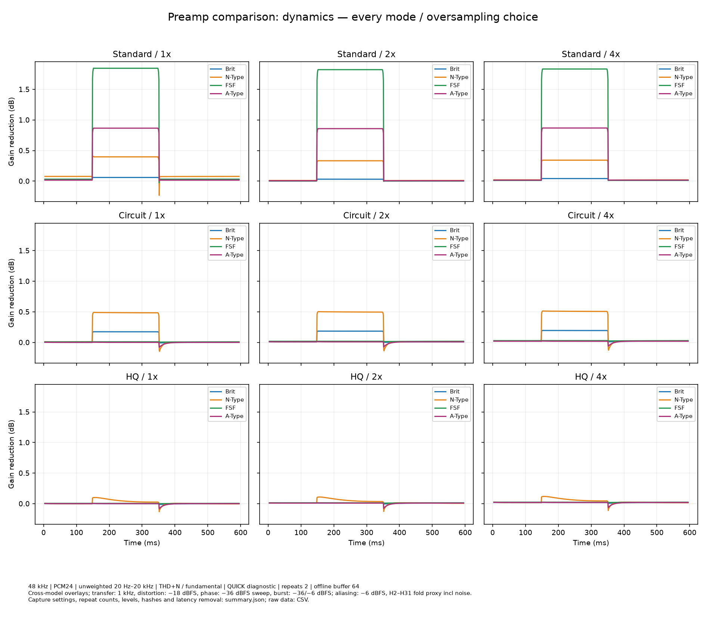
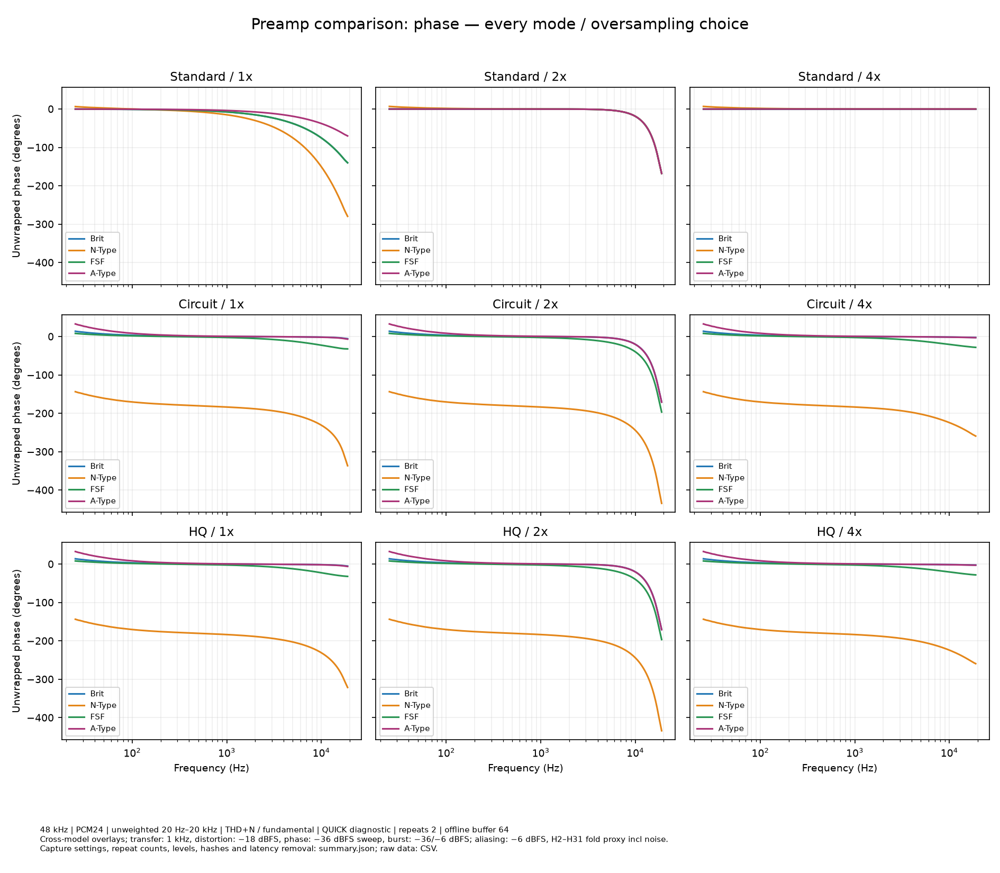
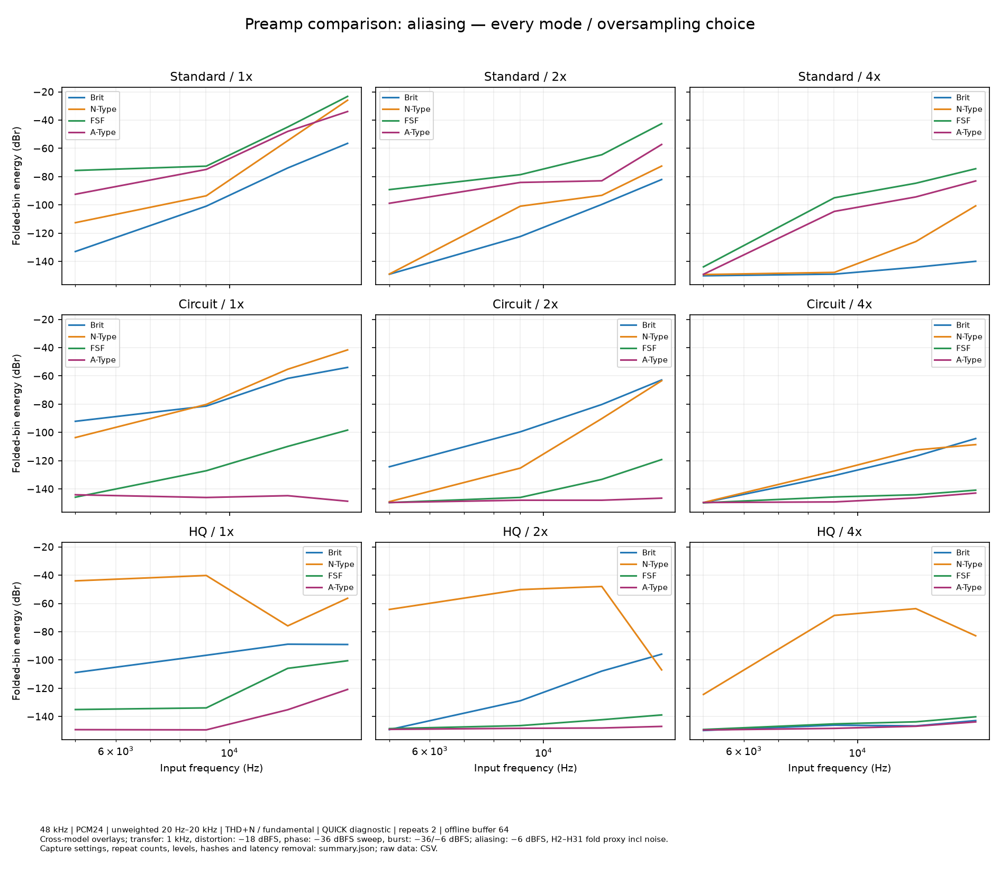
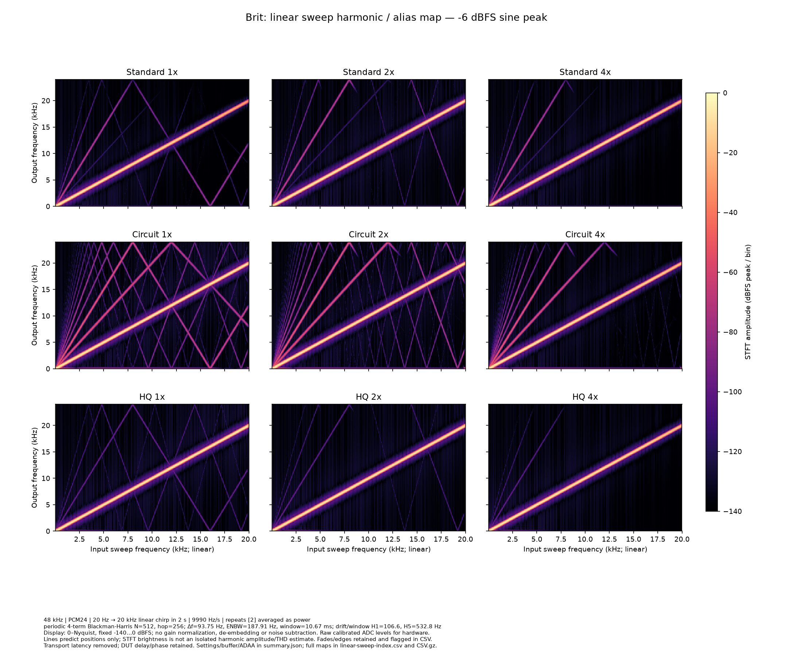
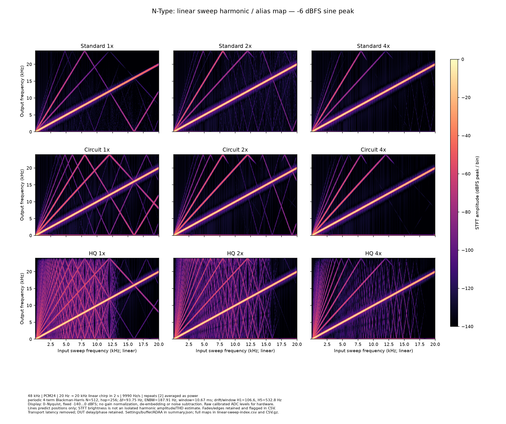
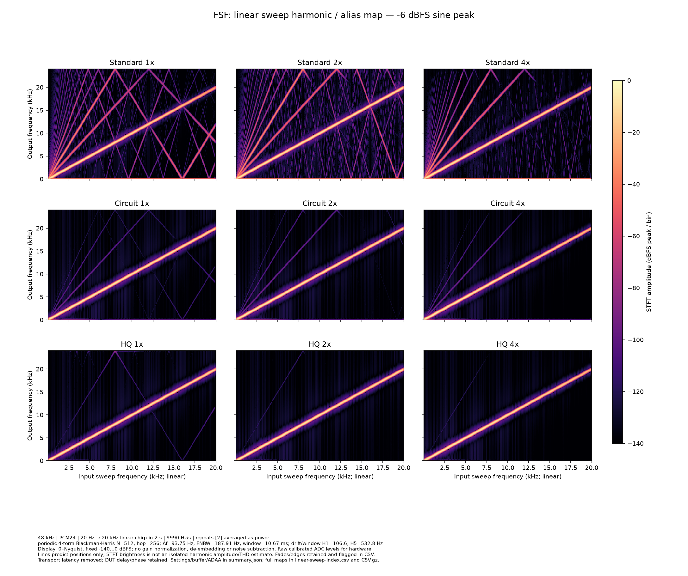
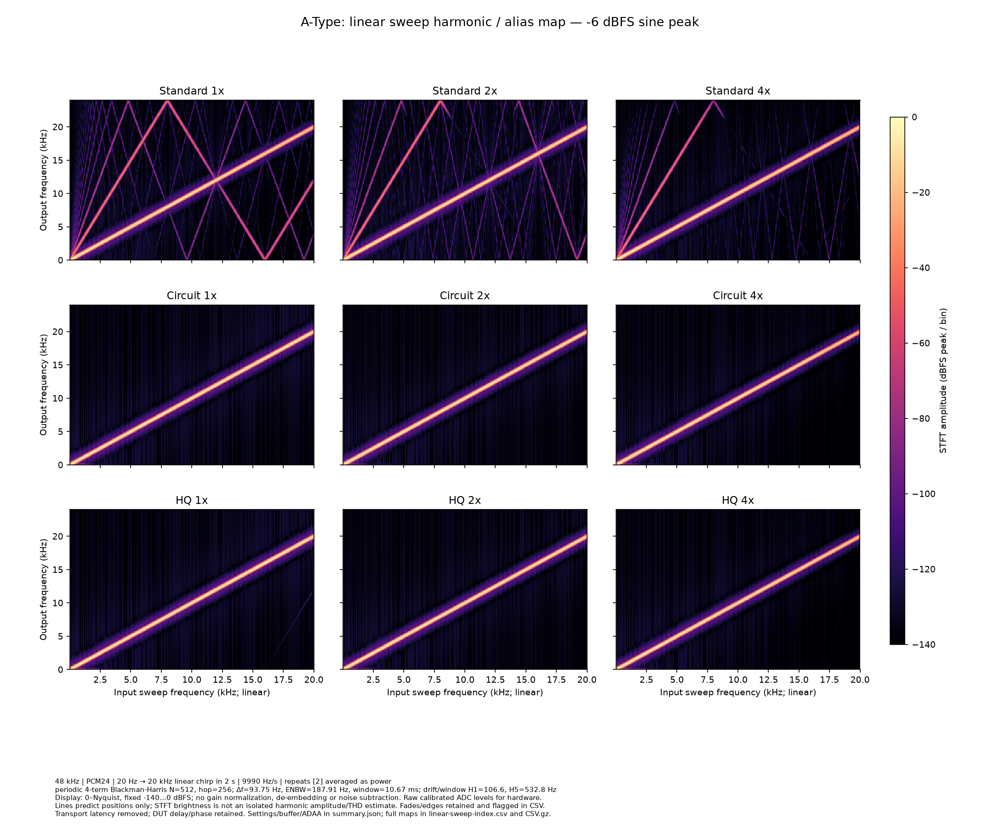

# OpenPreamp 1.0.2 audio measurements

Actual plugin diagnostics: **4 preamps × Standard/Circuit/HQ × explicit 1x/2x/4x**.
36 configurations, two offline captures each; 48 kHz, PCM24, 64-sample buffers,
identical 9.803-second quick fixture. No Default traces or synthetic hardware plots.
Settings, effective oversampling, ADAA policy, latency, capture hashes and analysis
versions are recorded in [summary.json](summary.json) and [configurations.csv](configurations.csv).

[Download every chart and raw CSV, including full spectrogram bins](https://github.com/MistaMin/OpenPreamp/releases/download/v1.0.2/OpenPreamp-1.0.2-Audio-Measurements.zip).
Download this directory and open [index.html](index.html) for the complete chart gallery.
The GitHub directory includes 92 PNG/SVG chart pairs and ordinary CSV tables;
large gzip CSV maps are distributed in the release archive. Original capture WAVs
are not bundled; their hashes and renderer provenance remain in the manifest.

## Reading the results

Standard and Circuit use ADAA at 1x and disable it at 2x/4x; HQ uses the full
component model without ADAA. 2x uses IIR resampling; 4x uses FIR resampling.
All plots use explicit rates. Circuit remains labeled Preview: the reduced models
have not passed every HQ sound-equivalence gate. A full product release does not
establish hardware equivalence or promote measured stage candidates into the engine.

These short diagnostics use four levels and short settling. They do not establish
a detailed knee, long recovery, listening approval or a final phase tolerance.
Repeated deterministic renders do not estimate analog noise. The input reference
shows the quantized stimulus; no physical hardware was captured.

## Comparisons

### Transfer and gain error

### Distortion

### Burst dynamics

### Phase and group delay

### Folded harmonic energy and residual

## Linear sweep harmonic and alias maps

Continuous 20 Hz–20 kHz linear chirps at −18/−6 dBFS; full 0–24 kHz output axis,
common −140…0 dBFS peak/bin scale. Periodic four-term Blackman–Harris STFT,
512 samples, hop 256, 93.75 Hz bin spacing, 187.908 Hz ENBW. Window duration
10.67 ms; fundamental sweep drift about 106.6 Hz/window (H5 about 532.8 Hz).
Window width, chirp drift and overlapping trajectories mean brightness is not an
isolated harmonic level. Use steady-tone tables for quantitative harmonic energy.
Clean maps and H1–H5/fold guides are both available in the gallery.

## Reproduce

See [measurement workflow](../MEASUREMENT_PIPELINE.md) for fixture generation,
offline capture, hardware calibration/import and analysis commands. The published
snapshot retains the original analysis provenance; binaries packaged later are
not represented as having produced these captures.
