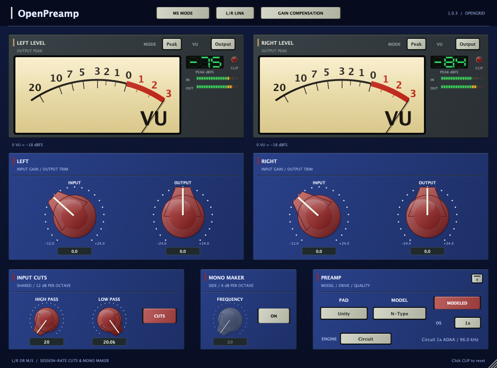
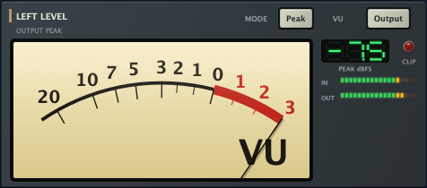
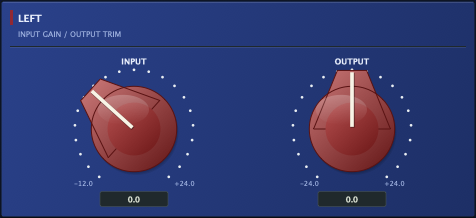
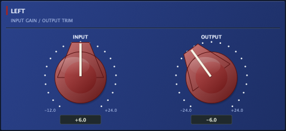
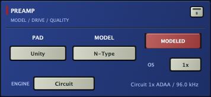
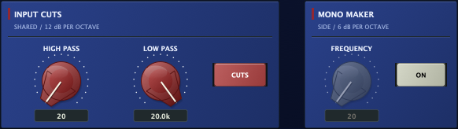
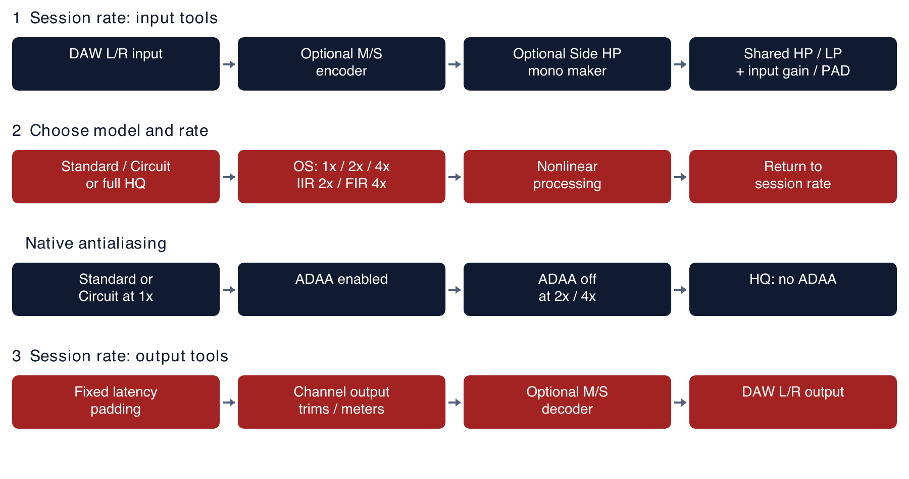
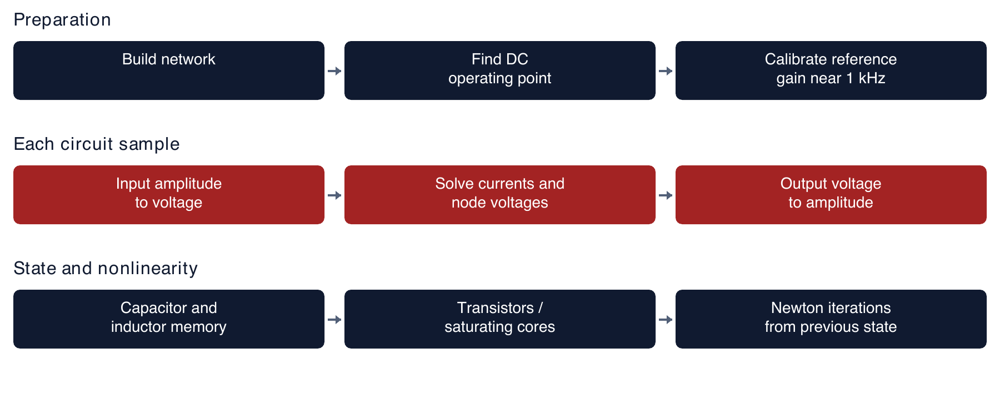
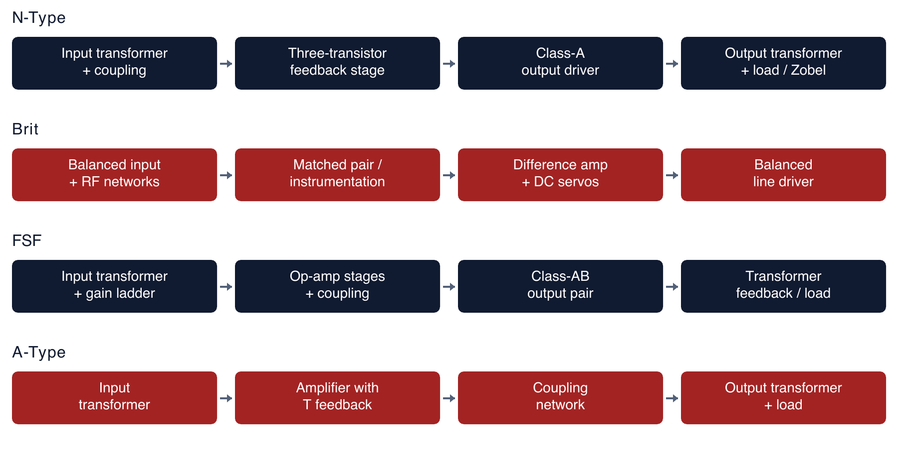

# OpenPreamp 1.0.3

## User manual

**OpenGrid / Marcos Deida**

A preamp, two independent meters, and a stereo or Mid/Side workflow. OpenPreamp combines component-network circuit simulation with a lighter antialiased model. It contains no parametric EQ, spectrum analyzer, separate harmonics engine, automatic loudness matching, or limiter.

**Public Mac formats:** VST3, Audio Unit, CLAP and LV2. Universal Apple Silicon / Intel build, macOS 11 or later. AAX is built privately and is excluded from the public download.

---

## 1. Installation and your first session

Close your DAW. Open the release disk image, double-click OpenPreamp-1.0.3-Installer.pkg and follow Installer. Administrator authorization is required. The package installs all four formats for every user in the main Library, and creates the format folders if needed.

| Format | Bundle | System installation folder |
|---|---|---|
| VST3 | OpenPreamp.vst3 | /Library/Audio/Plug-Ins/VST3/ |
| Audio Unit | OpenPreamp.component | /Library/Audio/Plug-Ins/Components/ |
| CLAP | OpenPreamp.clap | /Library/Audio/Plug-Ins/CLAP/ |
| LV2 | OpenPreamp.lv2 | /Library/Audio/Plug-Ins/LV2/ |

After installation, a dialog lists matching older or current OpenPreamp copies in the logged-in user's ~/Library/Audio/Plug-Ins folders. These can take precedence over the system installation. Move to Trash is the default. Choose Move to Trash only if you want to remove the listed user copies; they can be restored from Trash. Newer copies, renamed comparison plugins, redirected folders and other accounts are left alone.

Unattended installs retain user copies. To review them later, open Check User Copies.command in /Library/Application Support/OpenGrid/OpenPreamp. The manual and licenses are installed there too. Restart your DAW, rescan plugins, and choose OpenPreamp on a mono or stereo track. Each host supports its own subset of formats.

Start with INPUT and OUTPUT at 0 dB and PAD at Unity. N-Type is the initial model. MODELED starts on, ENGINE is HQ, and OS starts at 2x. CUTS starts on at 20 Hz high-pass and 20 kHz low-pass. MS MODE, L/R LINK and MONO MAKER start off. Meters initially show Output in Peak mode.

Turn INPUT up to drive the preamp harder. Turn OUTPUT down to compare the changed sound at a similar listening level. Enable GAIN COMPENSATION to pair those edits inversely; it starts off. Double-click an input or output knob to return it to 0 dB.

The window opens at 1000 x 740 and resizes proportionally from 400 x 296 to 1500 x 1110. Drag the lower-right resize handle. Small sizes trade label readability for screen space.

---

## 2. Metering: what each reading means

Each meter belongs to one processing stream. In ordinary stereo the streams are Left and Right. With MS MODE on, they are Mid and Side. Readings remain independent, even when gain controls are linked.

**VU / Input or Output:** click the displayed Input or Output key to toggle both meters together. Input is tapped before the mono maker, cuts and input gain. In M/S it is tapped after encoding. Output is tapped after the preamp, downsampling, latency padding and channel output gain; in M/S this is before decoding to L/R.

**MODE / Peak or RMS:** click Peak or RMS to switch both meters together. Peak drives the needles from the maximum sample amplitude accumulated between UI updates; the numeric display shows peak hold. RMS drives the needles from the square root of mean-square amplitude; the numeric display shows the current RMS level in dBFS. Both needle modes retain the display's mechanical smoothing. Peak mode is not a dedicated standards-calibrated PPM meter.

**Calibration:** 0 VU corresponds to -18 dBFS amplitude. RMS is shown without an added AES-17 +3 dB correction. A sine wave's RMS reading is therefore about 3 dB below its peak reading. These are sample-peak readings, not reconstructed intersample true peaks.

**Small IN / OUT bars:** always show sample peaks for the incoming and outgoing processing stream. They do not switch to RMS. The numeric Peak display holds a maximum for about 1.5 seconds, then falls at 12 dB per second. The small bars fall at 24 dB per second.

**CLIP lamp:** latches when a measured sample reaches approximately full scale. Click the lamp to reset it. It remains peak-based in RMS mode and is an indicator, not a limiter. Changing Input/Output resets the meter's hold, clip lamp and needle; changing Peak/RMS resets the needle position.

---

## 3. Gain, linking and compensation

| Control | Range or choices | Operation |
|---|---|---|
| INPUT, left | -12 to +24 dB | Drives Left, or Mid in M/S mode. Applied at session rate before upsampling. |
| OUTPUT, left | -24 to +24 dB | Trims Left, or Mid, after downsampling and before M/S decoding. |
| INPUT, right | -12 to +24 dB | Drives Right, or Side in M/S mode. |
| OUTPUT, right | -24 to +24 dB | Trims Right, or Side, after downsampling. |
| L/R LINK | Off / On | In L/R, both right gains follow the left gains and the right knobs are greyed out and disabled. |

Unlinking restores the independent right knob values; linking does not overwrite them. L/R LINK starts off. When MS MODE is on, L/R LINK remains visible but becomes grey and disabled. Its stored setting is ignored until normal L/R returns.

INPUT and PAD are external input trims. They drive a circuit whose internal gain network is held at unity; INPUT is not an adjustable feedback resistor in the circuit solver. Gain changes use 10 ms ramps at the session sample rate. OUTPUT and the M/S matrix also run at session rate.

Separate nonlinear circuit and ADAA histories are maintained for each channel. Linking trims does not share audio or solver state between Left and Right.

---

## 3. Gain compensation and wheel editing

**GAIN COMPENSATION:** links INPUT and OUTPUT inversely in dB. Enabling it leaves current values unchanged; moving either control moves its partner in the opposite direction. The pair stops when either reaches its limit. It is off initially and works independently for Left/Right or Mid/Side; L/R LINK still shares the left pair between stereo channels.

Compensation pairs drag, wheel, keyboard and double-click edits. It preserves the sum of the digital trims, not measured loudness through a nonlinear preamp. PAD remains independent. Both parameters are written to the host and can be recorded as automation. Direct host automation of one parameter changes only that parameter, without generating recursive edits.

**Mouse wheel:** raise or lower any gain or filter/mono-maker frequency while hovering over its knob. Clicking a knob selects it for wheel editing over the surrounding plugin area, even when the host does not grant keyboard focus. Hovering another knob takes precedence. Disabled right controls under L/R LINK remain disabled.

---

## 4. Preamp model, engine, oversampling and bypass

**MODEL:** lists Off first, then Brit, N-Type, FSF and A-Type. N-Type remains selected for a new instance. Saved model identities retain their meaning.

**PAD:** selects -20 dB, Unity or +10 dB, shared between input trims.

**MODELED:** off uses Standard, the lighter preamp models. On uses ENGINE.

**ENGINE:** HQ runs the full component network. Circuit runs the reduced approximation; it has not passed all HQ sound-equivalence gates. The factory engine is HQ.

**OS:** 1x, 2x or 4x, independently of engine. Initial rates are 1x for Standard/Circuit and 2x for HQ. Switching modes uses those initial rates until you choose a rate; after that, your choice persists across mode changes and is saved. There is no Default menu item. Standard/Circuit enable ADAA at 1x and disable it at 2x/4x. HQ uses no added ADAA. The rate label reports effective processing factor and rate when audio runs.

**Small bypass key:** skips preamp, input gain/PAD, cuts and mono maker; output trims and meters remain active.

**MODEL Off:** skips colored preamp processing but retains trims/PAD, cuts, mono maker and output trims.

---

## 5. Input cuts and mono maker

**HIGH PASS:** adjustable from 20 Hz to 20 kHz. Removes frequencies below its cutoff with a two-pole Butterworth IIR response: approximately -3 dB at cutoff and 12 dB per octave in the stopband. Its initial frequency is 20 Hz.

**LOW PASS:** adjustable from 20 Hz to 20 kHz. Removes frequencies above its cutoff using the same two-pole Butterworth design. Its initial frequency is 20 kHz. Frequencies are clamped below Nyquist at low session rates.

**CUTS:** toggles both filters. They share frequency settings between streams but have separate filter histories. They run at session rate before input gain and before preamp oversampling. In M/S, the shared cuts act separately on Mid and Side. Double-click HIGH PASS for 20 Hz or LOW PASS for 20 kHz.

The active default cuts are not an exact wire bypass at 20 Hz / 20 kHz. They still attenuate and rotate phase around those cutoffs. At 44.1 kHz, the low-pass transition is close to Nyquist and steepens near the top of the available digital band. This is expected filter behavior. A phase plot is not a frequency-magnitude plot; phase rotation is not a bass boost.

**MONO MAKER / ON:** enables a separate, one-pole high-pass only on Side. It starts off. FREQUENCY is adjustable from 20 to 500 Hz, initially 20 Hz; double-click restores 20 Hz. The slope is 6 dB per octave, with approximately -3 dB at cutoff. Mid is not filtered by this function.

Reducing low-frequency Side narrows bass rather than hard-switching everything below the knob value to complete mono. In L/R mode it temporarily encodes M/S, filters Side, and decodes before the cuts/input trims. In M/S mode it filters the already encoded Side. It runs at session rate, before the preamp, with 10 ms cutoff smoothing. Later independent gains or nonlinear processing can alter the final stereo balance; it is not a post-preamp brick-wall monoizer.

---

## 6. Mid/Side processing and signal flow

**MS MODE off:** ordinary L/R processing, the default. **MS MODE on:** INPUT, OUTPUT and meters become Mid and Side; L/R LINK is disabled. The host always receives L/R at the output.

The encoder is energy-preserving: M = (L + R) / sqrt(2), S = (L - R) / sqrt(2). The decoder is its exact inverse: L = (M + S) / sqrt(2), R = (M - S) / sqrt(2). Perfectly identical L/R feeds only Mid; perfectly opposite-polarity L/R feeds only Side. This normalization is not the 0.5-sum convention used by some other tools.

Encoding, mono maker, cuts and input trims occur before upsampling. Decoding occurs after the signal has been downsampled back to session rate, latency-padded and output-trimmed. Changing Side output changes stereo width before decoding. Separate Mid and Side drive settings can produce different saturation in the two streams.

At equal settings, clean processing with cuts and mono maker off reconstructs L/R apart from the reported latency. Nonlinear saturation deliberately changes that signal; a nonlinear M/S path is not equivalent to processing L/R with the same knob positions.

---

## 7. What circuit modeling actually does

Preparation builds the component network and finds its DC operating point. An audio sample becomes a calibrated input voltage. The solver balances current at circuit nodes and solves the interconnected voltages and branch currents together. The output node is converted back to a digital sample.

Resistors describe voltage/current relationships. Capacitors retain voltage and current history. Inductors retain flux and voltage history. Transistor junctions and saturating inductors are nonlinear, so the answer depends on the signal level and previous state. Newton iterations refine the solution from the previous sample. Difficult steps can use smaller input increments and additional iterations.

HQ costs more CPU because the component network is solved repeatedly. At 48 kHz, explicit 1x/2x/4x processes at 48/96/192 kHz. HQ defaults to 2x; Standard and Circuit default to 1x.

Small-signal output normalization is calibrated around 1 kHz. It sets a reference gain; it does not flatten the frequency response, erase distortion or automatically match loudness as INPUT increases.

Models include estimated transformer parameters and simplified devices. Brit and FSF use behavioral op-amps; A-Type's discrete op-amp is a placeholder. These are independent circuit simulations, not measured clones of a particular hardware unit, and the transformer model does not include magnetic hysteresis. Product and company names of inspirations do not imply endorsement.

---

## 8. The four component-network models

**N-Type:** an input transformer feeds a coupling capacitor and three-transistor feedback amplifier. Interstage coupling feeds a class-A output driver, a gapped output transformer and a 600-ohm load/Zobel network. The input transformer steps voltage down; the output transformer steps it up. Magnetizing inductance, leakage, winding resistance, coupling capacitors, device bias and load all participate in the same solve. Its internal feedback gain is held at the plugin's unity setting while INPUT drives it externally.

**Brit:** balanced input/RF networks feed a matched transistor pair with op-amp current feedback, an instrumentation pair, a difference amplifier, DC servos and a balanced line driver. The differential topology and its feedback shape the response and nonlinear behavior.

**FSF:** an input transformer feeds an attenuator/gain-switch network and op-amp stages, coupling, a class-AB transistor output pair and an output transformer/load. A transformer feedback winding participates in the output loop. The simulation contains a stepped internal gain network; the OpenPreamp INPUT knob is external drive rather than that hardware switch.

**A-Type:** an input transformer feeds an amplifier with a T feedback network, coupling, an output transformer and load. It models a transformer-coupled mic-preamp topology. Its discrete op-amp placeholder and estimated transformer parameters limit how closely it can represent hardware behavior.

The five MODEL choices include Off; Off is not a fifth circuit. Every active model owns independent state for the two processing streams.

---

## 9. Standard, Circuit and HQ compared

| Engine | Initial rate | Antialiasing and purpose |
|---|---|---|
| Standard | 1x | Lighter models; ADAA at 1x, off at 2x/4x. |
| Circuit | 1x | Reduced curves, filters and memory; residual ADAA at 1x, off at 2x/4x. |
| HQ | 2x | Full component solve; no added ADAA. |

All engines support explicit 1x/2x/4x. Standard has its own voicing. Circuit targets a cheaper HQ approximation but is not an accepted equivalent. Compare levels and program material; CPU and alias plots alone do not establish sound fidelity.

Circuit applies first-order ADAA to the nonlinear residual while preserving the quiet identity path. Prepared primitives avoid per-sample circuit solves. Native antialiasing reduces some folded energy; it does not eliminate all aliases or recreate the full circuit.

2x uses half-band polyphase IIR resampling; 4x uses two stages of half-band equiripple FIR resampling. These choices apply to every engine. Linear phase describes the 4x resampling filters, not the whole plugin.

All paths retain fixed latency derived from the rounded-up 4x filter delay. Mode changes reset histories without a transition crossfade. Cuts, trims, mono maker and M/S run at session rate. Old saved sessions retain previous rates; retired legacy rate values remain readable for old sessions and automation but are absent from the plugin menu. An explicit OS choice overrides that legacy policy. Existing parameter IDs/order are retained; gain compensation is appended after the existing OS parameter.

---

## 10. Working examples

**Gentle colour:** choose a model, enable MODELED, select HQ and start with OS at 2x, use Unity PAD, and raise INPUT a little. Reduce OUTPUT to compare at a similar level. Switch the meters to Input to inspect incoming level, then Output to inspect the processed level.

**More drive without a louder comparison:** increase INPUT or use +10 dB PAD, then lower OUTPUT. Distortion depends on the signal, model and mode. The clip light cannot tell you how much modeled analogue saturation is occurring inside the circuit.

**Tighter stereo bass:** enable MONO MAKER and slowly raise its frequency from 20 Hz. Listen to bass width and mono compatibility. The Side filter is gentle, not a hard crossover. Use MS MODE if you also want independent Mid/Side drive and output trims.

**Independent stereo drive:** leave MS MODE off and L/R LINK off. Adjust Left and Right independently. Enable L/R LINK when you want common gain control; unlink to recover the previous independent right settings.

**Inspect only the cuts:** choose MODEL Off, keep CUTS on, disable mono maker, and put all gains at 0 dB with Unity PAD. Use a magnitude response plot to assess level and a phase plot to assess phase rotation. Turning CUTS off provides the clean reference apart from latency.

**Compare processing modes:** level-match OUTPUT while comparing Standard, Circuit and HQ. They may differ in sound and bandwidth. Leave headroom in the downstream chain: this plugin has no output limiter.

---

## 11. Track formats, automation and troubleshooting

| Host track layout | Behavior |
|---|---|
| Mono input / mono output | One active preamp stream and left controls. Right controls, Link, MS MODE and mono maker are disabled; the right meter stays idle. |
| Stereo input / stereo output | Independent Left/Right or Mid/Side streams; all stereo tools are available. |
| Mono input / stereo output | Not supported directly. |
| Surround or other multichannel layouts | Not supported; channel layouts such as 5.1 and 7.1 are rejected. |

The host decides the bus format. A mono recording on a stereo track can still reach the plugin as two channels. Mono tracks retain session-rate cuts and gain; Circuit/HQ rate behavior is the same as stereo, using one active stream.

Parameters are saved by the host and can be automated. This includes model, PAD, gains, gain compensation, bypass, MODELED, ENGINE, OS, legacy 4x, meter source/mode, M/S, Link, cuts and mono maker. The meter choices change display behavior only. There is no separate preset browser inside the plugin.

Older pre-0.3 states copy their former stereo gain into the new right gain and leave the newly introduced cuts off. Later states missing Link or mono maker restore those features off. The 1.0 public build has no DEV editor or filesystem autosave; design CSVs are baked into the binary.

**Missing plugin:** confirm your host supports the installed format, copy the whole bundle, restart and rescan. **Grey control:** check mono track format, L/R LINK, MS MODE, bypass, model Off, CUTS or MONO MAKER state. **High CPU:** compare Standard, Circuit and HQ at explicit rates; higher session rates increase circuit work. **No low-bass or top-end bypass:** active 20 Hz / 20 kHz cuts still filter; disable CUTS for the reference.

---

## 12. Source, licenses and release scope

OpenPreamp's project source is MIT licensed; the included LICENSE contains the copyright and permission terms. GoodLookinUI is separately MIT licensed. Third-party code and SDKs retain their own licenses. The MIT project license does not relicense JUCE, Apple SDKs or the optional Avid AAX SDK.

The official binary-use terms are in BINARY_LICENSE.txt. THIRD_PARTY_NOTICES.txt identifies the included components, and the complete third-party license texts and VST usage/trademark notices are in Licenses/third-party. These files accompany the public package and each plugin's own license folder. Keep the notices with redistributed copies and consult the applicable dependency licenses when building a new binary.

The public 1.0.3 Mac package contains VST3, AU, LV2 and CLAP, this manual, release notes and licenses. AAX binaries and the Avid SDK are excluded. AAX builds are private development artifacts; creating an AAX binary is not proof that it can load in Pro Tools without the required Avid/PACE signing.

Source and release downloads: https://github.com/MistaMin/OpenPreamp

More circuit detail: CIRCUIT_EXPLAINED.md in the source repository. ADAA reference: https://www.research.ed.ac.uk/files/34115216/bilbao_pdf.pdf

---

## 13. Audio measurement report

The 1.0.3 development report compares Brit, N-Type, FSF and A-Type across Standard/Circuit/HQ and explicit 1x/2x/4x: 36 configurations and 72 independent offline captures. All use the same 48 kHz, PCM24 fixture, fixed 64-sample buffer and documented settings. Default is omitted from measurements.

Charts cover gain/linearity, harmonics and THD+N, burst dynamics, phase/group delay, coherent folded-harmonic energy and linear-frequency sweep maps at -18/-6 dBFS. The linear maps include clean and predicted H1-H5/fold views, common absolute color limits, FFT/window/ENBW/sweep-drift captions and full-resolution CSV data. They are diagnostic maps; use steady tones for quantitative harmonic levels.

Gain compensation is disabled for these fixed-setting measurements. The report contains actual plugin results and input-reference maps. There are no synthetic hardware plots or physical hardware measurements. Circuit has known fidelity limits; these quick fixtures are development evidence, not a complete sound, listening or real-host acceptance test.

Read the published report and download the complete chart/CSV archive from the repository and 1.0.3 release assets:

https://github.com/MistaMin/OpenPreamp/blob/main/Docs/Measurements-1.0.3/REPORT.md

Reproduction and calibrated hardware-import instructions are in Docs/MEASUREMENT_PIPELINE.md.
