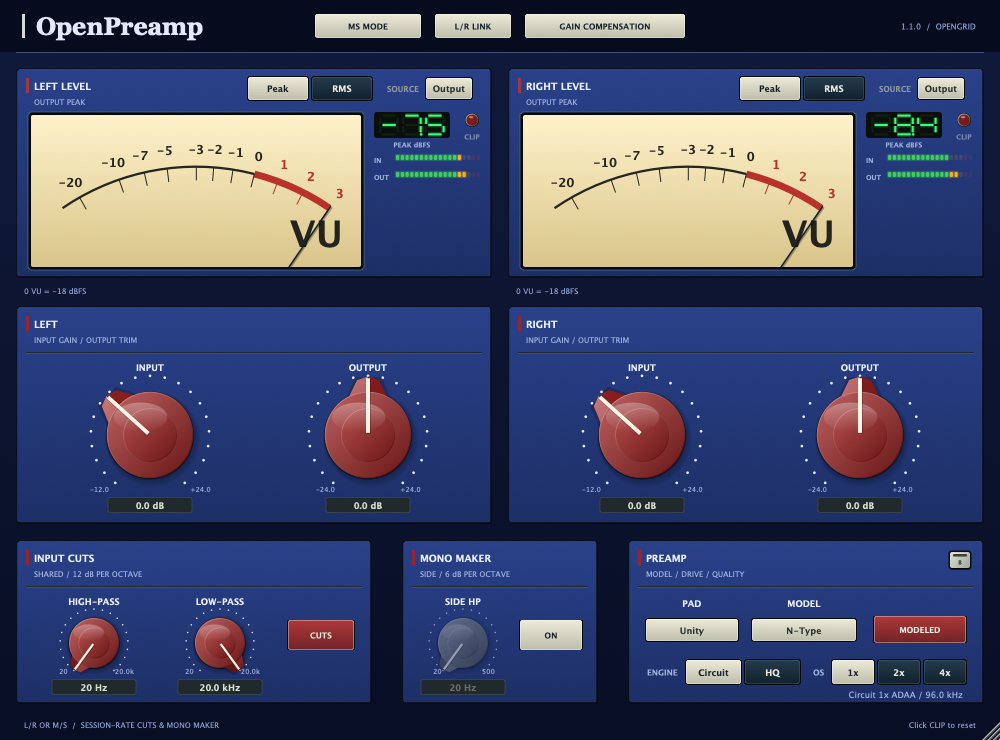
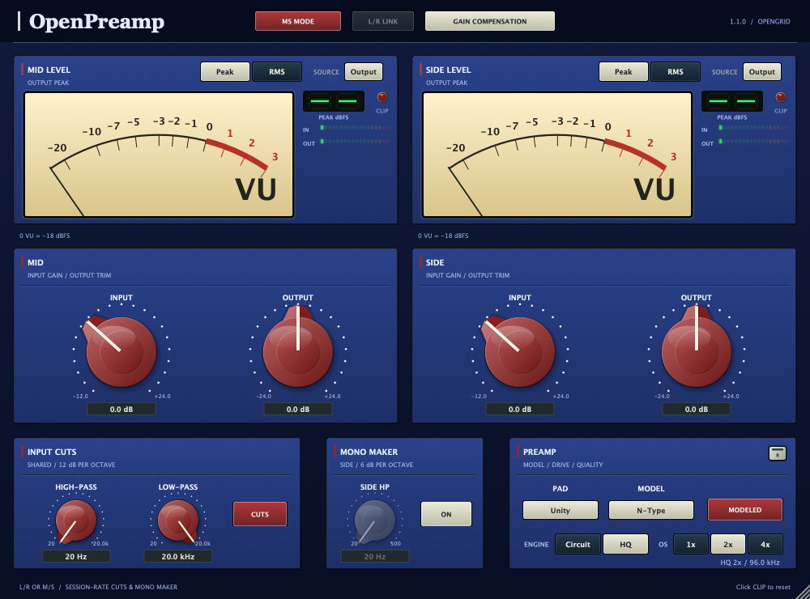
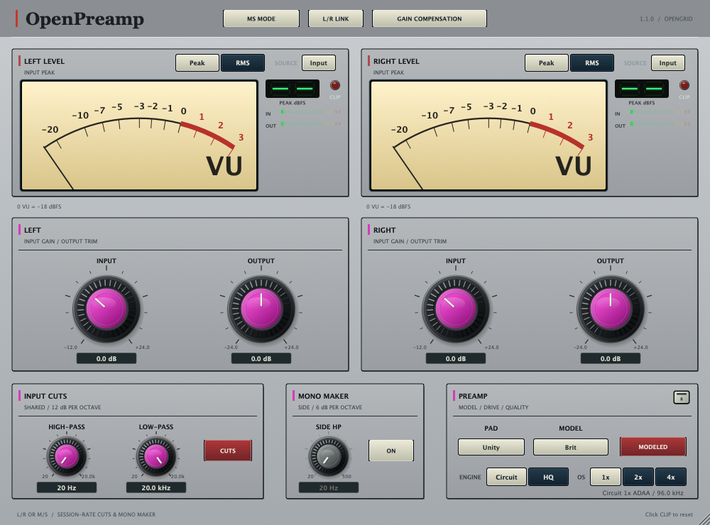
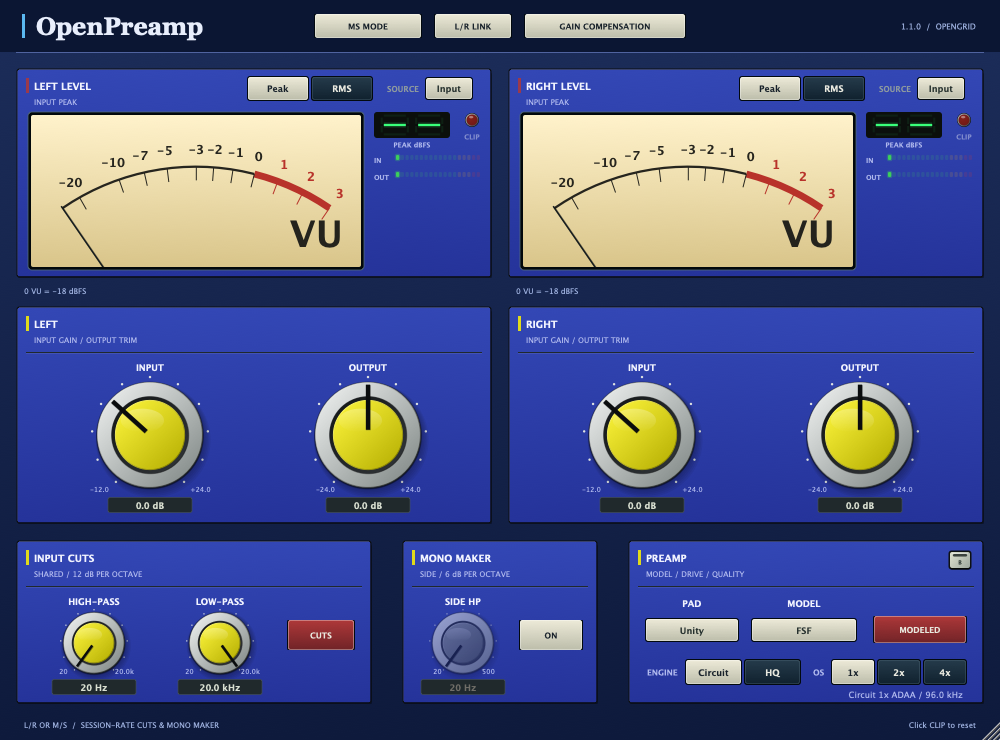
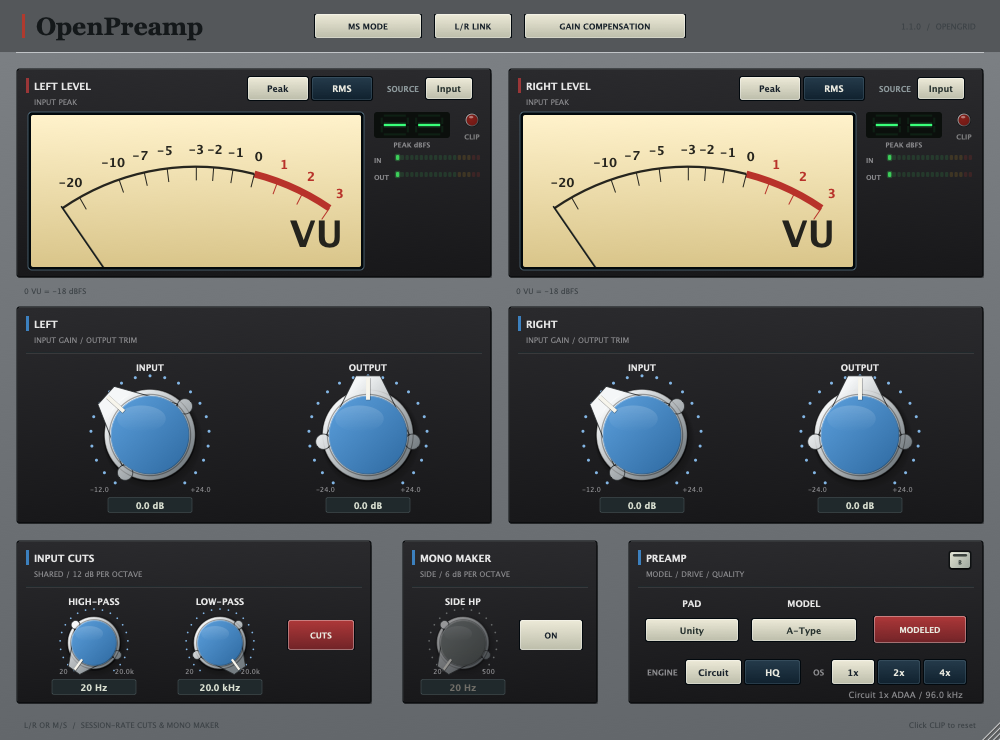

# OpenPreamp

**Circuit colour. Independent meters. Stereo and Mid/Side control.**



OpenPreamp is a preamp and metering tool from **OpenGrid / Marcos Deida**,
extracted from HybridEQ. Four preamp models, two independent processing streams,
and a compact resizable interface - without a parametric EQ or separate
harmonics engine.

**1.1.1 release.** [Latest packaged release: 1.1.1](https://github.com/MistaMin/OpenPreamp/releases/tag/v1.1.1) ·
[Illustrated PDF manual](output/pdf/OpenPreamp-User-Manual.pdf) ·
[Online manual](Docs/UserManual.md) · [Version history](CHANGELOG.md)

## Shape the drive, choose the model

- **Off first in the model menu**, then Brit, N-Type, FSF and A-Type. New
  instances select N-Type. Model colours remain distinct on the refreshed navy
  hardware faceplate, with tactile vector knobs and cream VU meters.
- **Standard:** lighter preamp models. **Circuit:** reduced circuit models.
  **HQ:** full component networks; the factory default engine.
- Explicit **1x / 2x / 4x** oversampling for every engine. Initial rates are 1x
  for Standard/Circuit and 2x for HQ; a manual rate choice is then retained. 2x uses IIR; 4x uses FIR resampling.
- **ADAA** runs at 1x for Standard and Circuit, and turns off at 2x/4x.
  HQ does not use ADAA. Legacy sessions retain their previous rate settings.
- Independent **input and output trims**, shared **PAD**, and **L/R LINK**.
- **GAIN COMPENSATION** moves input/output inversely, independently of L/R Link.
  Wheel-edit hovered or clicked gain/frequency knobs. The top controls are centered.
- **MS MODE** encodes before the preamp and decodes after downsampling. Link
  greys out while Mid and Side remain independently adjustable.
- Shared **12 dB/octave high/low cuts** and a **6 dB/octave Side-only mono maker**.
  All cuts, gain trims and M/S matrices run at session rate outside oversampling.
- Two independent meters with **Input/Output** source keys and visible **Peak/RMS**
  choices selected directly on click, peak bars, peak hold and resettable clip lamps.
- Proportional resizing from **400 x 296** to **1500 x 1110**; default 1000 x 740.



The 1.1.1 update brings 47 procedural 3D hardware knob styles via GoodLookinUI, refined model aesthetics,
direct Circuit/HQ and 1x/2x/4x selectors, readouts with units, and compensation-link indicators. Audio processing and parameter identities are unchanged.
The [tube preamp plan](Docs/TUBE_PREAMP_ENGINEERING_PLAN.md) is retained and deferred.

## Model appearances





## Install

The Mac package contains universal **Apple Silicon and Intel** versions of
**VST3, Audio Unit, CLAP and LV2**, for **macOS 11 or later**, plus the illustrated
manual and complete license notices. Quit your DAW, open the PKG inside the DMG,
and follow Installer. Administrator authorization is required.

| Format | System folder |
|---|---|
| VST3 | `/Library/Audio/Plug-Ins/VST3/` |
| AU | `/Library/Audio/Plug-Ins/Components/` |
| CLAP | `/Library/Audio/Plug-Ins/CLAP/` |
| LV2 | `/Library/Audio/Plug-Ins/LV2/` |

After installing, a dialog lists matching older/current copies in your user
plugin folders and asks whether to move them to Trash. **Move to Trash** is
the default. Newer copies, renamed comparison plugins and other accounts are
left alone. Unattended installs keep user copies; review them later using
`/Library/Application Support/OpenGrid/OpenPreamp/Check User Copies.command`.
Restart your DAW and rescan. See [installer details](Docs/MAC_INSTALLER.md).

**AAX is excluded from public downloads.** Its optional SDK and private build
are not distributed. Mono and stereo buses are supported; mono-to-stereo and
surround layouts are not.

## How the modeling works

The full circuit path builds component networks, finds their operating points
and repeatedly solves node voltages and branch currents. Capacitors, inductors,
transistors and saturating cores carry state and shape the response. The INPUT
knob drives a fixed-unity internal gain network externally.


HQ selects the full component model. Oversampling is a separate control;
linear phase describes 4x FIR resampling, not the entire plugin. Circuit
uses reduced approximations and has not passed all HQ sound-equivalence gates. Models use estimated parameters
and simplified devices; they are not measured clones of specific hardware.

See the [user manual](Docs/UserManual.md) and
[circuit explanation](CIRCUIT_EXPLAINED.md) for diagrams, model topologies,
calibration, latency, antialiasing and practical limits.

## Build from source

Project source is **MIT licensed**. Clone with submodules:

```sh
git clone --recurse-submodules https://github.com/MistaMin/OpenPreamp.git
cd OpenPreamp
cmake -S . -B build -DCMAKE_BUILD_TYPE=Release -DOPENPREAMP_DEVELOPER_MODE=OFF
cmake --build build --config Release --target OpenPreamp_VST3 OpenPreampSmoke OpenPreampADAA -j8
./build/OpenPreampSmoke_artefacts/Release/OpenPreampSmoke
./build/OpenPreampADAA_artefacts/Release/OpenPreampADAA
```

On macOS, also build `OpenPreamp_AU`, `OpenPreamp_LV2` and `OpenPreamp_CLAP`.
On Linux, VST3/LV2/CLAP targets are available; the workflow builds downloadable
CI artifacts. Mac universal packages are added to the release after signing. Optional `OpenPreamp_AAX`
builds stay private. Legacy HybridEQ targets remain in the source tree; its
installer and release scripts do not package OpenPreamp.

Developer builds use `-DOPENPREAMP_DEVELOPER_MODE=ON`. **DEV** opens separate
**Knobs / layout** and **Model looks** tabs. Changes apply immediately and
autosave to `Designs/OpenPreampKnobs.csv` and `Designs/OpenPreampLooks.csv`.
Production builds bake those files into the binary and have no DEV tools or
filesystem autosave. See [release process](Docs/RELEASE_PROCESS.md).

## Measurement development

Development measurement tools compare all four preamps across Standard/Circuit/HQ
and 1x/2x/4x, with calibrated hardware import, repeated captures, aliasing tests,
linear sweep harmonic maps, CSV data and PNG/SVG plots.

[Read the 1.0.3 measurement report](Docs/Measurements-1.0.3/REPORT.md) ·
[Download all charts and raw CSV maps](https://github.com/MistaMin/OpenPreamp/releases/download/v1.0.3/OpenPreamp-1.0.3-Audio-Measurements.zip) ·
[Reproduce the measurements](Docs/MEASUREMENT_PIPELINE.md).

The report contains 92 chart pairs from 72 actual offline captures at 48 kHz/PCM24.
No physical hardware or synthetic hardware overlays are presented. Short fixtures
are development diagnostics; Circuit retains its documented fidelity limits.

## Licensing


[MIT project license](LICENSE) ·
[Official binary-use terms](Licenses/OpenPreamp-BINARY_LICENSE.txt) ·
[Third-party notices](Licenses/OpenPreamp-THIRD_PARTY_NOTICES.txt)

GoodLookinUI is independently MIT licensed. JUCE and format SDKs retain their
own licenses; the MIT source license does not relicense those dependencies.
Complete third-party texts and trademark notices accompany the downloads and
each plugin. Independent builders must comply with the licenses applicable to
their build. Avid SDKs and AAX binaries are never included in the public package.
